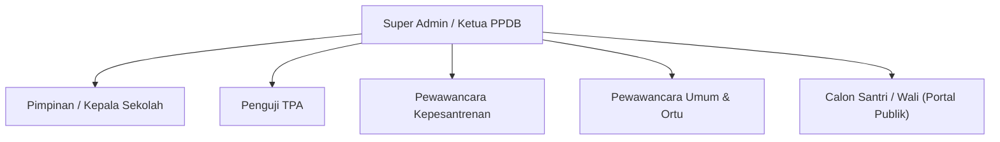

# 3. User Personas & Role-Based Access Control (RBAC)

Sistem **Edu-Test** menerapkan pemisahan tugas (*separation of duties*) berbasis peran untuk menjaga kerahasiaan dan integritas nilai:

---

## 3.1 Rincian Persona & Hak Akses

### 1. Super Admin / Ketua Panitia PPDB
- **Deskripsi**: Penanggung jawab operasional seleksi penerimaan santri baru.
- **Hak Akses**:
  - Full CRUD data peserta (import CSV/Excel, tambah, edit nomor tes).
  - Mengatur konfigurasi gelombang seleksi dan alokasi ruang ujian.
  - Membuka kunci (*unlock*) nilai jika ada penguji yang mengajukan revisi resmi.
  - Mengakses seluruh master ledger, laporan, dan fungsi export.
  - Menetapkan batas cut-off kuota kelulusan bersama pimpinan.

### 2. Penguji TPA (Tes Potensi Akademik)
- **Deskripsi**: Guru/staf penguji yang mengoreksi lembar jawaban atau mengawasi pelaksanaan CBT TPA.
- **Hak Akses**:
  - Membuka daftar peserta pada ruang ujian TPA yang ditugaskan.
  - Menginput jumlah jawaban benar untuk 12 subtes TPA (EYD s/d Karakter).
  - Menyimpan draf penilaian dan menekan tombol *Lock & Submit Final TPA*.
  - Tidak memiliki akses ke rubrik kepesantrenan maupun form catatan wawancara orang tua.

### 3. Penguji / Pewawancara Kepesantrenan
- **Deskripsi**: Asatidz/asatidzah yang menguji kemampuan baca Al-Qur'an, hafalan hadits, kitab kuning, adzan, dan bacaan sholat.
- **Hak Akses**:
  - Mengakses daftar peserta sesi wawancara kepesantrenan.
  - Mengisi instrumen rubrik (skala 1–4) untuk 7 bidang kepesantrenan.
  - Mengisi catatan fasilitator per bidang uji.
  - Mengunci nilai (*Submit Final Rubrik*).

### 4. Pewawancara Kualitatif (Umum & Orang Tua)
- **Deskripsi**: Guru BK atau tim konseling yang mewawancarai kesiapan calon santri dan komitmen wali santri.
- **Hak Akses**:
  - Mengakses formulir isian narasi wawancara umum santri.
  - Mengakses formulir isian narasi wawancara orang tua/wali santri.
  - Menuliskan catatan rekomendasi khusus tanpa memberikan poin angka.

### 5. Pimpinan / Kepala Sekolah
- **Deskripsi**: Pejabat yang mengambil keputusan kelulusan akhir.
- **Hak Akses**:
  - Read-only ke seluruh ledger nilai, peringkat TPA, peringkat kepesantrenan, dan peringkat paralel.
  - Akses ringkasan dossier profil peserta (skor + narasi esai).
  - Melakukan simulasi ambang batas kuota (cut-off slider).
  - Mengesahkan dan menerbitkan surat keputusan hasil seleksi.

---

## 3.2 Matriks Matriks Izin Akses (RBAC Matrix)

| Modul / Fitur | Super Admin | Penguji TPA | Penguji Kepesantrenan | Pewawancara Ortu/Umum | Pimpinan |
|---|:---:|:---:|:---:|:---:|:---:|
| **Manajemen Peserta & Gelombang** | CRUD | Read | Read | Read | Read |
| **Input Nilai TPA** | Edit (Override) | CRUD (Assigned) | No | No | Read |
| **Input Rubrik Kepesantrenan** | Edit (Override) | No | CRUD (Assigned) | No | Read |
| **Input Isian Wawancara Esai** | Edit (Override) | No | No | CRUD (Assigned) | Read |
| **Buka Kunci Nilai (Unlock)** | Yes | No | No | No | No |
| **Ledger Auto-Ranking** | Full | No | No | No | Full |
| **Penetapan Kuota & Pleno** | Manage | No | No | No | Approve |
| **Export Rekap Excel / PDF** | Yes | No | No | No | Yes |
