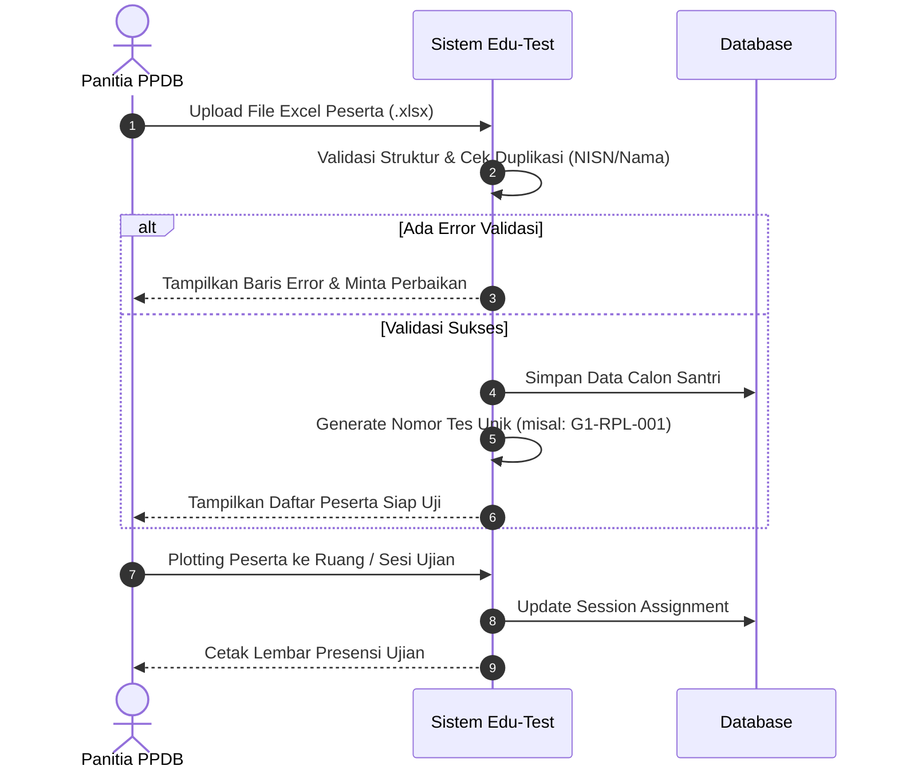

# Flow 01: Import Peserta & Pembagian Sesi Ujian

## 1. Diagram Alur

## 2. Deskripsi Langkah
1. Panitia mengunggah berkas Excel data calon pendaftar dari formulir pendaftaran awal.
2. Sistem memvalidasi apakah kolom-kolom utama terisi (Nama, NISN, Asal Sekolah, Pilihan Jurusan).
3. Sistem secara otomatis membentuk Nomor Tes sesuai pola gelombang dan jurusan.
4. Panitia menetapkan jadwal sesi uji (misal Sesi Pagi 08.00–12.00) dan mencetak kartu/daftar hadir.

