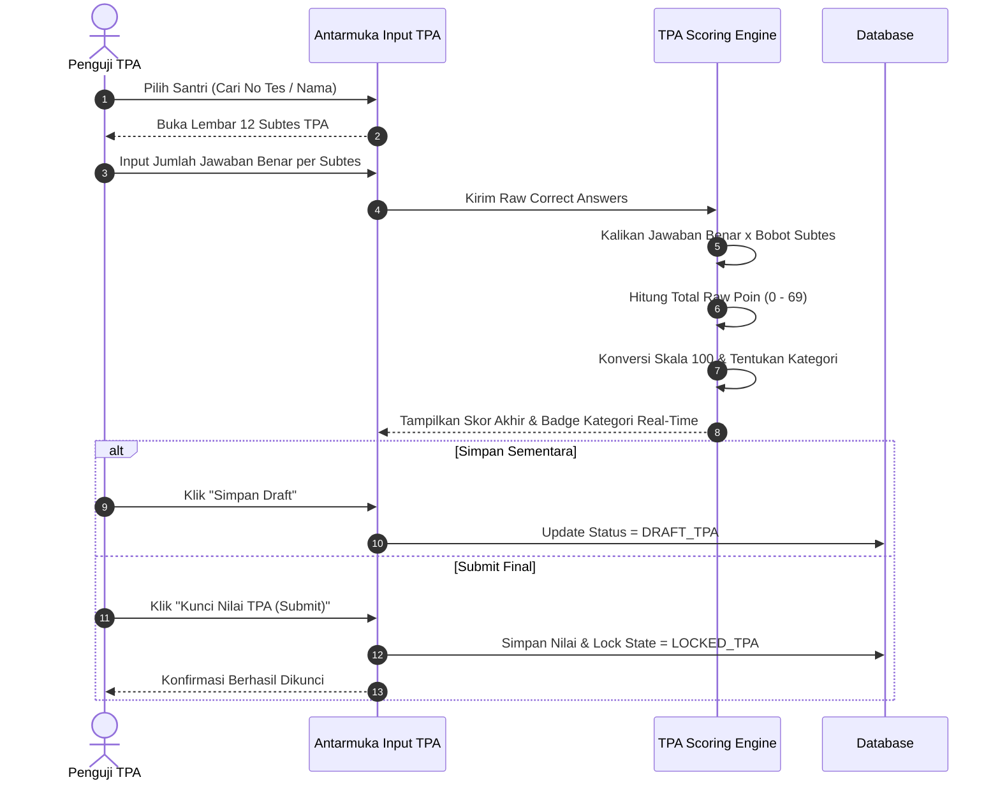

# Flow 02: Skoring Tes Potensi Akademik (TPA)

## 1. Diagram Alur

## 2. Deskripsi Langkah
1. Penguji membuka form TPA santri bersangkutan.
2. Mengisi angka jawaban benar untuk masing-masing dari 12 subkategori:
   - Bahasa Indonesia (EYD, Kohesi, Logika, Analogi, Wacana).
   - Matematika (Operasi Hitung, Bangun Ruang).
   - Bahasa (Inggris, Arab).
   - Al-Qur'an (Tahfidz, Tahsin).
   - Karakter.
3. Mesin otomatis mengalikan bobot, menjumlahkan skor mentah, dan memetakan ke skor skala 100 serta kategori kualitatif.
4. Penguji melakukan submit final yang mengunci form dari perubahan tidak sengaja.

