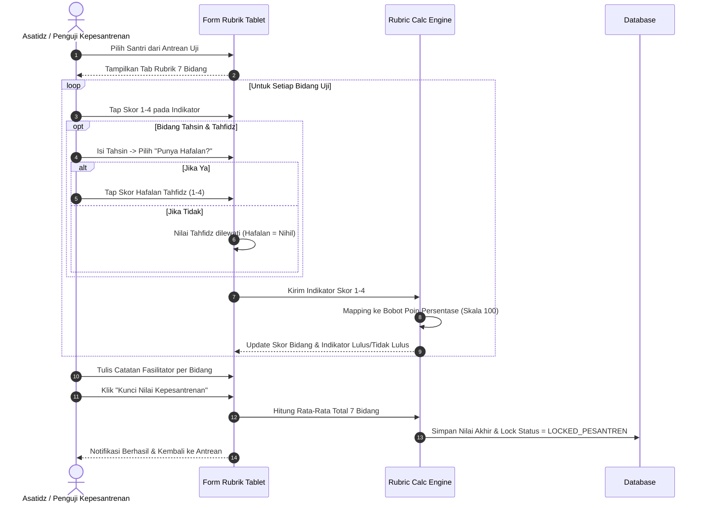

# Flow 03: Penilaian Rubrik Kepesantrenan & Ibadah

## 1. Diagram Alur

## 2. Deskripsi Langkah
1. Penguji membuka instrumen rubrik di tablet saat santri masuk ruangan.
2. Menilai ke-7 bidang secara berurutan:
   - **Tahsin & Tahfidz**: Uji baca 5 baris $\to$ Cek kepemilikan hafalan $\to$ Jika punya hafalan, uji hafalan.
   - **Kitab Kuning**: Baca teks gundul, nahwu-shorof, terjemah pegon, pemahaman isi.
   - **Bahasa Inggris & Arab**: Speaking, pronunciation, writing, vocabulary.
   - **Hadits**: Hafalan hadits, kelancaran, makna, adab.
   - **Adzan**: Kelancaran lafazh, makhraj, kualitas suara.
   - **Bacaan Sholat**: Kelancaran lafazh bacaan sholat, makhraj/tajwid, adab.
3. Mesin kalkulasi menghitung rata-rata total dan memeriksa passing grade per bidang.
4. Penguji mengunci nilai.

