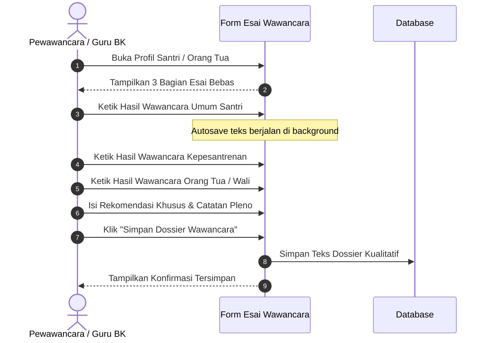

# Flow 04: Wawancara Kualitatif (Santri & Orang Tua)

## 1. Diagram Alur

## 2. Deskripsi Langkah
1. Pewawancara membuka lembar catatan wawancara.
2. Menggali aspek kualitatif tanpa memberi nilai angka:
   - Kesungguhan santri, minat kejuruan, dan kepribadian.
   - Kesiapan orang tua, dukungan finansial, dan komitmen terhadap aturan pondok.
3. Seluruh catatan tersimpan dalam satu dossier terpadu untuk ditinjau oleh pimpinan saat pleno.

