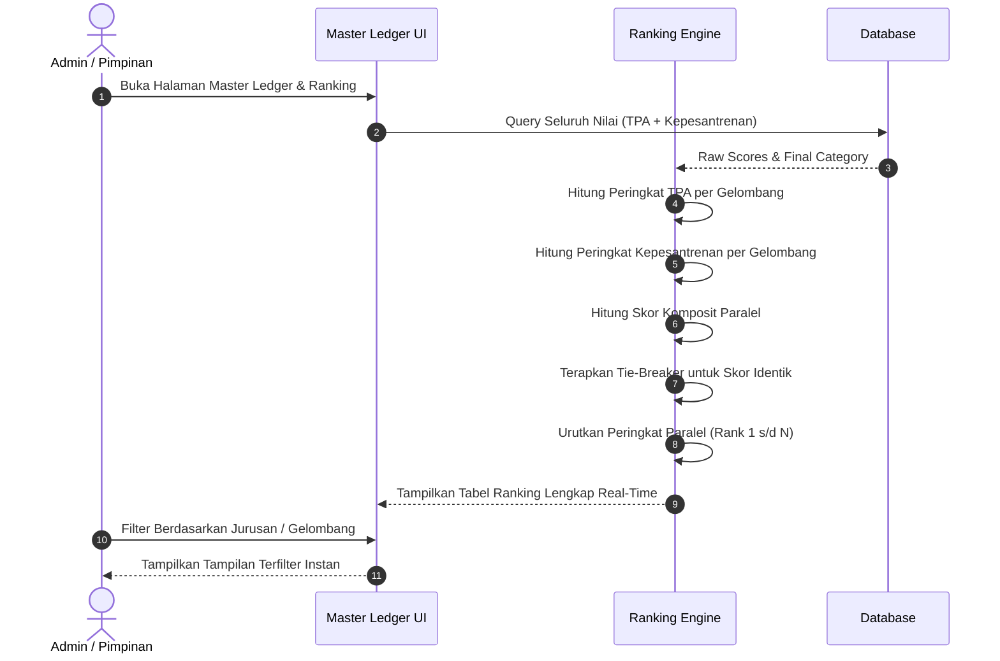

# Flow 05: Auto-Ranking Paralel & Ledger Rekap

## 1. Diagram Alur

## 2. Deskripsi Langkah
1. Sistem mengumpulkan nilai akhir dari meja TPA dan meja Kepesantrenan.
2. Mesin ranking secara otomatis menyusun:
   - **Peringkat TPA**
   - **Peringkat Kepesantrenan**
   - **Peringkat Paralel Umum**
3. Jika ada dua santri dengan skor gabungan sama, sistem menerapkan urutan penentu (*tie-breaker*):
   - Prioritas 1: Nilai Rata-rata Kepesantrenan lebih tinggi.
   - Prioritas 2: Nilai Karakter & Logika TPA lebih tinggi.
   - Prioritas 3: Waktu pendaftaran lebih awal.

