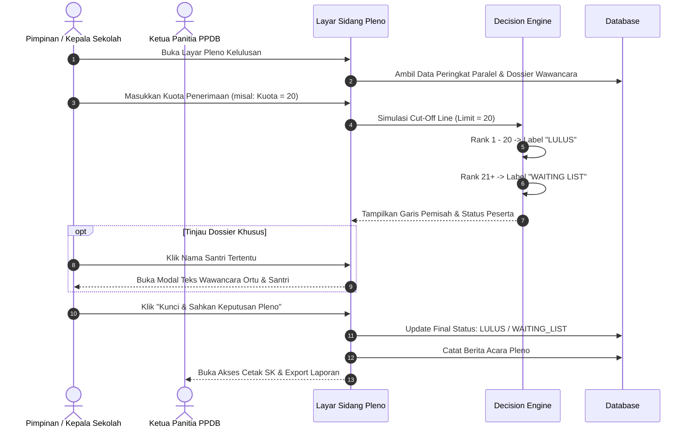

# Flow 06: Sidang Pleno & Penetapan Kelulusan

## 1. Diagram Alur

## 2. Deskripsi Langkah
1. Pimpinan sekolah dan ketua panitia menggelar sidang pleno.
2. Pimpinan menginput daya tampung santri baru.
3. Sistem secara otomatis menerapkan garis batas:
   - Santri di dalam kuota berstatus: **LULUS**.
   - Santri di luar kuota berstatus: **WAITING LIST GELOMBANG BERIKUTNYA** (bukan tidak lulus).
4. Pimpinan mengesahkan keputusan, dan surat pengumuman dapat langsung diunduh/dicetak.

