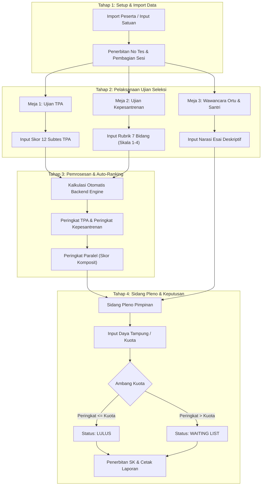

# 7. User Flow Architecture & Workflows

Modul 07 mendefinisikan seluruh alur kerja sistem **Edu-Test** dari awal pendaftaran hingga publikasi hasil akhir seleksi:

## Daftar Berkas Alur Rinci:
1. [01-flow-import-dan-sesi-ujian.md](./01-flow-import-dan-sesi-ujian.md)
2. [02-flow-skoring-tpa.md](./02-flow-skoring-tpa.md)
3. [03-flow-rubrik-kepesantrenan.md](./03-flow-rubrik-kepesantrenan.md)
4. [04-flow-wawancara-kualitatif.md](./04-flow-wawancara-kualitatif.md)
5. [05-flow-auto-ranking-paralel.md](./05-flow-auto-ranking-paralel.md)
6. [06-flow-sidang-pleno-dan-hasil.md](./06-flow-sidang-pleno-dan-hasil.md)
