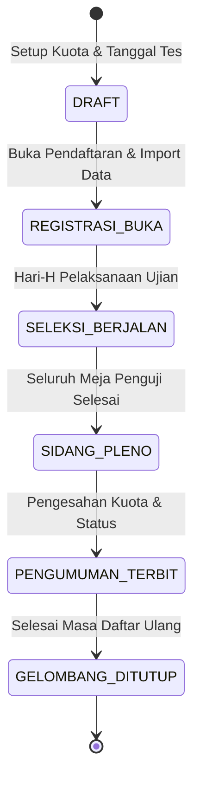

# BP-01: Siklus Gelombang Seleksi & Kuota Daya Tampung

## 1. Siklus Hidup Gelombang Seleksi
Setiap periode penerimaan santri baru terdiri dari beberapa gelombang seleksi (misal Gelombang 1, Gelombang 2):

## 2. Alokasi Kuota Daya Tampung
1. **Kuota Utama**: Ditentukan sebelum sidang pleno (misal: 25 santri per jurusan).
2. **Kapasitas Cadangan**: Peserta dengan nilai di atas passing grade namun di luar batas kuota utama dialokasikan ke antrean waiting list.
3. **Rollover Kuota**: Jika ada santri berstatus Lulus yang mengundurkan diri atau tidak melakukan daftar ulang hingga batas waktu, kursi otomatis ditawarkan kepada peserta nomor urut 1 di antrean waiting list.

