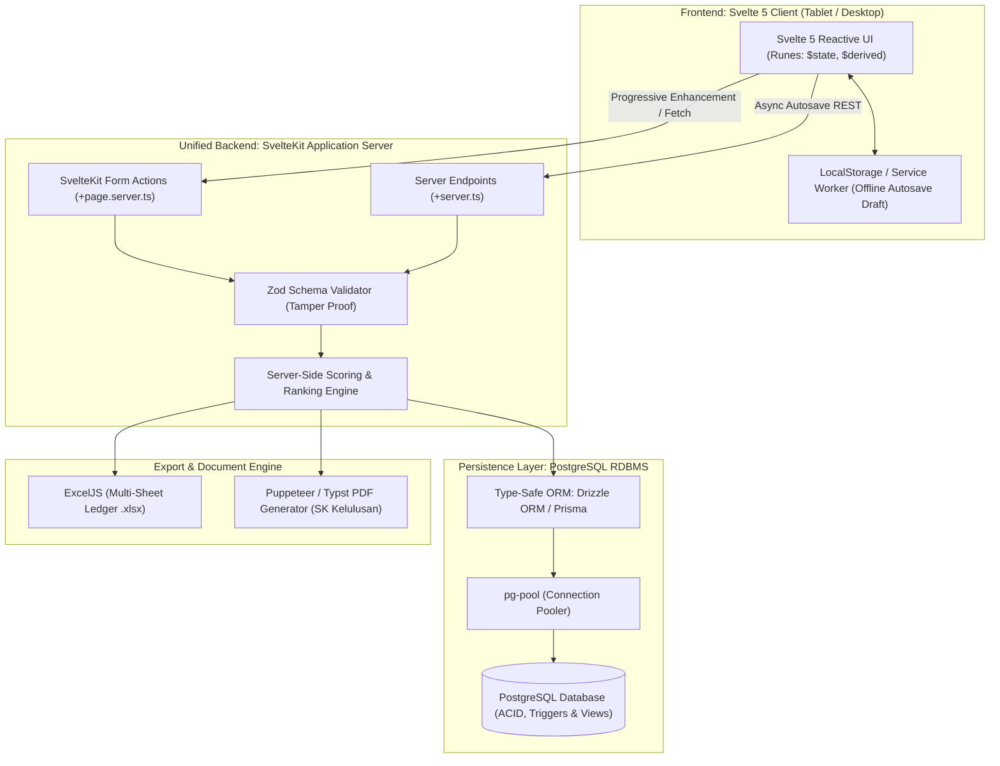
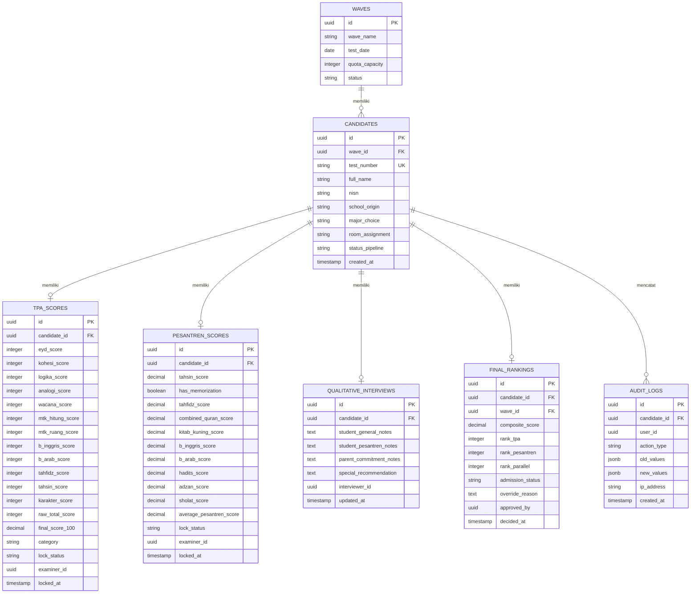

# 10. Technical Stack & Architecture Specification (SvelteKit Fullstack + PostgreSQL)

## 10.1 Arsitektur Unified Fullstack: SvelteKit + PostgreSQL

Sistem **Edu-Test** dibangun dengan pendekatan arsitektur **Unified Fullstack** menggunakan **SvelteKit** dan basis data relasional **PostgreSQL**. Pilihan ini memberikan efisiensi tinggi, bundle size ultra-ringan pada tablet penguji, reaktivitas instan tanpa overhead virtual DOM, serta integritas data ACID yang kokoh untuk kalkulasi skor dan pemeringkatan paralel.



---

## 10.2 Rincian Komponen Teknologi

| Lapisan | Teknologi | Versi Target | Alasan Pemilihan & Peran |
|---|---|---|---|
| **Fullstack Framework** | **SvelteKit** | 2.x (Svelte 5) | Menyatukan frontend dan backend dalam 1 codebase TypeScript, native server actions, performa reaktivitas tinggi tanpa VDOM |
| **Reaktivitas UI** | **Svelte 5 Runes** | 5.x (`$state`, `$derived`, `$effect`) | Kalkulasi real-time saat penguji mengetuk tombol skala 1–4, debounce autosave efisien di tablet |
| **Database** | **PostgreSQL** | 16+ | Dukungan transaksi ACID, indexing multi-kolom untuk ranking paralel, integritas foreign keys, dan field JSONB audit |
| **ORM & Migrations** | **Drizzle ORM** *(atau Prisma)* | Latest | Type-safe query builder, migrasi skema otomatis, zero runtime overhead, dan integrasi native dengan driver `pg` |
| **Validasi Skema** | **Zod** | 3.x | Validasi input batas jumlah benar TPA dan skala 1-4 rubrik di server-side sebelum masuk database |
| **Styling & Theme** | **Tailwind CSS** | 3.4+ / 4.x | Utilitas styling responsif, ergonomi sentuh tablet, tema *Deep Ocean Blue* (menghindari ungu) |
| **Export Generator** | **ExcelJS & PDFKit/Puppeteer** | Latest | Ekspor master ledger multi-sheet dan pencetakan surat kelulusan resmi dengan kop sekolah |

---

## 10.3 Skema Basis Data PostgreSQL (DDL & Entity Relationships)



---

## 10.4 Pola Implementasi SvelteKit

### 1. Server Actions (`+page.server.ts`)
Setiap form submission (seperti penguncian nilai TPA, rubrik kepesantrenan, dan penetapan kuota pleno) diproses melalui **SvelteKit Form Actions**:
- **Progressive Enhancement**: Form tetap dapat bekerja dengan fallback standar browser dan di-enhance oleh `enhance` SvelteKit tanpa full page reload.
- **CSRF Protection**: Proteksi bawaan dari SvelteKit terhadap serangan *Cross-Site Request Forgery*.
- **Direct Database Transaction**: Eksekusi penyimpanan nilai dan kalkulasi skor dalam satu transaksi PostgreSQL `BEGIN ... COMMIT` untuk memastikan atomisitas.

### 2. Svelte 5 Runes untuk Ergonomi Tablet
- **`$state`**: Menyimpan nilai instrumen aktif dan status tombol pilihan skala 1–4.
- **`$derived`**: Menghitung pratinjau skor mentah dan konversi skala 100 secara instan di sisi klien sebelum penguji menekan submit final.
- **`$effect`**: Menjalankan mekanisme debounced *autosave* ke endpoint `+server.ts` setiap jeda 5 detik saat penguji mengetik teks narasi wawancara.

### 3. PostgreSQL Query Optimization untuk Ranking
Pemeringkatan paralel dihitung efisien menggunakan fitur *Window Functions* native PostgreSQL:
```sql
SELECT 
    c.id AS candidate_id,
    c.test_number,
    c.full_name,
    t.final_score_100 AS tpa_score,
    p.average_pesantren_score AS pesantren_score,
    ROUND((t.final_score_100 + p.average_pesantren_score) / 2.0, 2) AS composite_score,
    DENSE_RANK() OVER (ORDER BY t.final_score_100 DESC) AS rank_tpa,
    DENSE_RANK() OVER (ORDER BY p.average_pesantren_score DESC) AS rank_pesantren,
    DENSE_RANK() OVER (
        ORDER BY 
            ROUND((t.final_score_100 + p.average_pesantren_score) / 2.0, 2) DESC,
            p.average_pesantren_score DESC,
            t.final_score_100 DESC,
            c.created_at ASC
    ) AS rank_parallel
FROM candidates c
JOIN tpa_scores t ON t.candidate_id = c.id
JOIN pesantren_scores p ON p.candidate_id = c.id
WHERE c.wave_id = $1;
```
