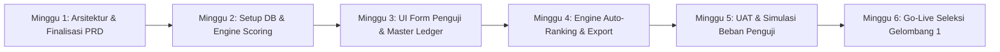

# 14. Timeline & Roadmap Pengembangan

Rencana kerja pengembangan sistem **Edu-Test** menuju pelaksanaan seleksi penerimaan santri baru tahun ajaran 2027/2028:

## Rincian Fase:
1. **Fase 1 (Minggu 1) - Arsitektur & Spesifikasi**:
   - Penyusunan PRD modular 15 bab lengkap.
   - Perancangan skema relasi database dan formula matematis TPA serta Kepesantrenan.
2. **Fase 2 (Minggu 2) - Backend & Scoring Logic**:
   - Pembuatan skema tabel database (PostgreSQL/MySQL).
   - Implementasi scoring algorithm TPA (69 poin ke 100).
   - Implementasi lookup formula rubrik kepesantrenan (skala 1-4 ke persentase).
3. **Fase 3 (Minggu 3) - Antarmuka Penguji**:
   - Pembangunan form input TPA dan antarmuka sentuh tablet untuk 7 bidang kepesantrenan.
   - Pembangunan form esai wawancara kualitatif dengan autosave.
4. **Fase 4 (Minggu 4) - Auto-Ranking & Pleno Engine**:
   - Integrasi master ledger, pemeringkatan paralel otomatis, dan penanganan tie-breaker.
   - Pembangunan layar simulator kuota pleno dan generator export Excel/PDF.
5. **Fase 5 (Minggu 5) - UAT & Gladi Bersih**:
   - Uji coba simulasi input simultan oleh 10 meja penguji di jaringan lokal sekolah.
   - Verifikasi 100% kecocokan angka rekap dengan perhitungan manual.
6. **Fase 6 (Minggu 6) - Go-Live Operasional**:
   - Deployment production dan pendampingan teknis hari-H seleksi Gelombang 1.
